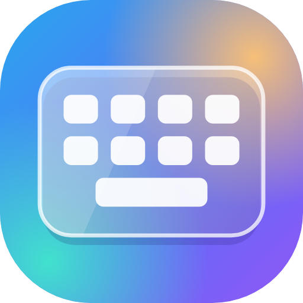

# GlassType



**Android-Tastatur mit einstellbarer Transparenz, integrierter Spracheingabe und „Blick unter die Tastatur“.**
Basiert auf [LeanType](https://github.com/LeanBitLab/LeanType) (Fork von [HeliBoard](https://github.com/Helium314/HeliBoard) / OpenBoard / AOSP LatinIME) und übernimmt dessen kompletten Funktionsumfang, inklusive Wischeingabe, schwebender Tastatur, Split-Layout für Foldables, Zwischenablage und Emoji-Suche.

*English summary: GlassType is a LeanType/HeliBoard based Android keyboard that adds an adjustable transparent keyboard (real see-through onto the app behind, no permissions needed), built-in voice typing via the system speech recognizer, a hold-to-peek button to look behind the keyboard, and quick toggles for transparency and "keyboard over app" mode.*

Zielgeräte: Samsung Galaxy Z Fold 3 und Galaxy S23 Ultra (läuft auf Android 6.0 und neuer).

> **Status:** Testversion. Auf einem Galaxy Z Fold 3 (Android 15) und einem Galaxy S23 Ultra (Android 17) getestet und funktionierend: transparente Tastatur, Transparenz-Schnellschalter, Tastatur über der App, Auge (unter die Tastatur schauen), integrierte Spracheingabe, schwebende Tastatur mit Transparenz, Auge und Verschieben sowie Wischeingabe auf Deutsch (mit Umlauten, geteilt und ungeteilt). Fehler bitte als [Issue](https://github.com/olobarius/GlassType/issues) melden.

---

## Inhalt

- [Download und Installation](#download-und-installation)
- [Ersteinrichtung](#ersteinrichtung)
- [Neue Funktionen im Überblick](#neue-funktionen-im-überblick)
- [Transparente Tastatur](#transparente-tastatur)
- [Schnellschalter Transparenz](#schnellschalter-transparenz)
- [Tastatur über der App (nicht hochschieben)](#tastatur-über-der-app-nicht-hochschieben)
- [Unter die Tastatur schauen (Auge)](#unter-die-tastatur-schauen-auge)
- [Integrierte Spracheingabe](#integrierte-spracheingabe)
- [Schwebende Tastatur](#schwebende-tastatur)
- [Größe und Form der Tasten](#größe-und-form-der-tasten)
- [Deutsche Tastatur und Wischeingabe](#deutsche-tastatur-und-wischeingabe)
- [Symbolleiste: die neuen Knöpfe](#symbolleiste-die-neuen-knöpfe)
- [Version, Updates und „Über“](#version-updates-und-über)
- [Bekannte Einschränkungen](#bekannte-einschränkungen)
- [Selbst bauen](#selbst-bauen)
- [Lizenz und Danksagung](#lizenz-und-danksagung)

---

## Download und Installation

1. Auf dem Handy die neueste APK unter **[Releases](https://github.com/olobarius/GlassType/releases)** öffnen und herunterladen.
2. Die APK antippen. Beim ersten Mal fragt Android nach der Erlaubnis **„Unbekannte Apps installieren“** für den Browser bzw. „Eigene Dateien“. Erlauben, dann installieren.
3. GlassType hat eine eigene Paket-ID (`de.glasstype.keyboard`) und lässt sich **parallel zu LeanType, Gboard, SwiftKey oder der Samsung-Tastatur** installieren.

> Die aktuellen Testversionen sind Debug-Builds und erscheinen als **„GlassType debug“**. Ein Update von einer älteren Testversion installiert man einfach darüber.

## Ersteinrichtung

1. **GlassType** öffnen und dem Einrichtungsassistenten folgen: Tastatur aktivieren und als Standard wählen.
   Bei Samsung alternativ: *Einstellungen → Allgemeine Verwaltung → Tastaturliste und Standard*.
2. **Wörterbuch laden:** *Einstellungen → Sprachen & Layouts → Wörterbücher* → **Deutsch** antippen, im Fenster nach unten scrollen und bei **„Hauptwörterbuch: Deutsch“** auf *Herunterladen* tippen (für weitere Sprachen genauso). Die App enthält keine Wörterbücher, ohne sie gibt es keine Wortvorschläge, keine Autokorrektur und keine Wischeingabe. Ein neues Wörterbuch wirkt sofort, ohne Neustart.
3. **Wischeingabe:** *Einstellungen → Gesten-Tippen → Gesten-Tippen-Bibliothek laden → Bibliothek herunterladen*. Die App startet danach einmal neu. Details unter [Deutsche Tastatur und Wischeingabe](#deutsche-tastatur-und-wischeingabe).
4. **Mikrofon erlauben:** *Einstellungen → Spracheingabe → Mikrofonberechtigung* antippen und erlauben.
5. **Transparenz einschalten:** siehe [Transparente Tastatur](#transparente-tastatur).
6. **Vorschläge in allen Apps:** Manche Apps, vor allem Browser und Web-Apps, verbieten der Tastatur Wortvorschläge. Dann bleibt die Vorschlagsleiste beim Tippen leer. Abhilfe: *Einstellungen → Vorschläge → Immer Vorschläge anzeigen* einschalten und *Nicht immer Vorschläge für Web-Editierfelder anzeigen* ausschalten.
7. **Autokorrektur (optional):** *Einstellungen → Textkorrektur → Autokorrektur* einschalten. Details unter [Autokorrektur](#autokorrektur).

---

## Neue Funktionen im Überblick

| Funktion | Kurz erklärt | Aktivieren |
|---|---|---|
| **Transparente Tastatur** | Echte Durchsicht auf die App hinter der Tastatur. Deckkraft für Hintergrund und Tasten getrennt einstellbar. Keine Berechtigungen nötig. | *Einstellungen → Aussehen → Transparenz* |
| **Schnellschalter Transparenz** | Ein Tipp schaltet die Transparenz an/aus. | Tropfen-Symbol in der Symbolleiste |
| **Tastatur über der App** | Die angedockte Tastatur schiebt die App nicht hoch, sondern liegt darüber. | Ebenen-Symbol in der Symbolleiste oder *Aussehen → Transparenz* |
| **Unter die Tastatur schauen** | Auge gedrückt halten: Tastatur verschwindet, darunter Verdecktes wird sichtbar. Loslassen und weitertippen. | Auge-Symbol in der Symbolleiste (und unten in der schwebenden Tastatur) |
| **Integrierte Spracheingabe** | Spracherkennung des Handys direkt in der Tastatur, Live-Text beim Sprechen, durchgehendes Zuhören, kein Plugin nötig. Erkennungsdienst wählbar. | Mikrofon-Symbol; Standard-Anbieter |
| **Deutsch und Englisch gemischt** | Englisch als Zusatzsprache der deutschen Tastatur: Vorschläge aus beiden Wörterbüchern, ohne Umschalten. Die Spracheingabe erkennt dann ebenfalls beide Sprachen (Android 14+). Deutsch bleibt dabei bevorzugt. | *Sprachen & Layouts → Deutsch → Mehrsprachiges Tippen*; Gewichtung unter *Vorschläge → Hauptsprache bevorzugen* |
| **Autokorrektur für zwei Sprachen** | Standardstufe „Ausgewogen“. Richtig geschriebene englische Wörter bleiben im deutschen Text stehen. | *Einstellungen → Textkorrektur → Autokorrektur* |
| **Transparente schwebende Tastatur** | Transparenz und Auge-Knopf funktionieren auch im schwebenden Modus. | Symbol „Schwebend“ in der Symbolleiste |
| **Platz für Vorschläge** | Auf schmalen Bildschirmen bleiben neben den Vorschlägen nur so viele Symbole, dass die gewünschte Mindestzahl an Vorschlägen passt (Standard 3). Der Pfeil rechts klappt den Rest aus, langes Drücken rastet ein. | Automatisch; Anzahl unter *Einstellungen → Vorschläge → Mindestens sichtbare Vorschläge* |
| **Größe der Symbole** | Automatisch (Standard): Die Symbole werden nur kleiner, wenn der Platz knapp ist. Alternativ fest Normal, Kompakt (85 %) oder Klein (70 %). | *Einstellungen → Symbolleiste → Größe der Symbole* |
| **Tastenecken wie bei Gboard** | Tasten mit leicht abgerundeten Ecken statt rund. Nur ?123 und Enter bleiben Kapseln. Dazu größere Tasten, größere Schrift und engere Abstände als bei LeanType. | *Einstellungen → Aussehen → Design → Tastenecken* |
| **Deutsch mit Umlauttasten** | Eigene Tasten für Ü, Ö, Ä und ß; auf dem aufgeklappten Fold ungeteilt über die ganze Breite. | Standard |
| **Zahlenzeile** | Eigene Reihe mit 1 bis 0 über den Buchstaben. | Standard; abschaltbar unter *Optionen → Zusätzliche Tasten* |
| **Geprüfte Wischeingabe-Bibliothek** | Die heruntergeladene Gesten-Bibliothek wird nur mit der bekannten Prüfsumme übernommen. | *Gesten-Tippen → Bibliothek laden* |
| **Eigene Version und Update-Prüfung** | Eigene Versionsnummer, Update-Prüfung gegen die GlassType-Releases, „Über“ mit Credits und Link zu LeanType. | *Einstellungen → Updates* bzw. *Über* |

---

## Transparente Tastatur

### Was sie macht

Der Tastaturhintergrund wird wirklich durchsichtig: Man sieht, was die App hinter der Tastatur zeigt. Über dem App-Inhalt liegt die Farbe deines Tastatur-Designs mit einstellbarer Deckkraft, damit die Tasten lesbar bleiben.

- Am besten zusammen mit [Tastatur über der App](#tastatur-über-der-app-nicht-hochschieben). Nur dann liegt echter App-Inhalt hinter der Tastatur. Wird die App hochgeschoben, sieht man dahinter meist nur eine einfarbige Fläche.
- **Keine Berechtigungen nötig.** GlassType liest dafür nichts vom Gerät, weder Hintergrundbild noch Fotos oder Dateien.

### Aktivieren

1. *Einstellungen → Aussehen*. Ganz oben steht der Bereich **Transparenz**.
2. **Transparente Tastatur** einschalten.
3. Einstellen:
   - **Deckkraft Hintergrund** (0–100 %): wie stark die Designfarbe über dem App-Inhalt liegt. 0 % = App voll sichtbar, 100 % = undurchsichtig. Standard 35 %.
   - **Deckkraft Tasten** (0–100 %): Deckkraft der Tastenflächen. Standard 55 %. Popups und Vorschlagsfenster bleiben zur besseren Lesbarkeit immer deckend.
   - **Tastatur liegt über der App**: siehe unten.

> Bis Version 0.5.0 gab es zusätzlich den Modus „Startbildschirm scheint durch“. Er brauchte je nach Gerät den Fotozugriff oder sogar „Zugriff auf alle Dateien“ und funktionierte auf Android 17 trotzdem nicht. Er wurde entfernt. Wer ihn eingestellt hatte, bekommt automatisch die echte Transparenz. Die Berechtigung „Zugriff auf alle Dateien“ fordert GlassType nicht mehr an.

---

## Schnellschalter Transparenz

**Tropfen-Symbol** in der Symbolleiste über der Tastatur:

- Ein Tipp: Transparenz **an**, nächster Tipp: wieder **aus**.
- Ist das Symbol hervorgehoben, ist die Transparenz an.
- Beim Umschalten baut sich die Tastatur einmal kurz neu auf.

---

## Tastatur über der App (nicht hochschieben)

Normalerweise schiebt eine angedockte Tastatur die App nach oben bzw. verkleinert sie. Mit diesem Schalter **legt sich die Tastatur über die App**, die App behält ihre volle Größe.

- **Ebenen-Symbol** in der Symbolleiste: Tipp schaltet um, hervorgehoben = Tastatur liegt über der App.
- Dauerhaft einstellbar unter *Aussehen → Transparenz → Tastatur liegt über der App*.
- **Tipp:** Zusammen mit der **transparenten Tastatur** und niedriger Hintergrund-Deckkraft sieht man den App-Inhalt durch die Tastatur.
- Gilt nur für die angedockte Tastatur. Die schwebende Tastatur liegt ohnehin immer über der App.

So sieht der Unterschied aus (getestet in Samsung Notes auf dem Fold 3):

| Ebenen-Symbol | Verhalten |
|---|---|
| **aus** (Standard) | Die App wird hochgeschoben. Die Zeile mit dem Cursor und die Formatierungsleiste der App stehen direkt über der Tastatur. |
| **an** (hervorgehoben) | Die App behält die volle Höhe, ihre untere Leiste liegt hinter der Tastatur. Neu getippte Zeilen unten verschwinden hinter der Tastatur, bis man wieder umschaltet. |

Das Umschalten wirkt sofort, auch mitten im Tippen. Schaltet man zurück, rutscht die App wieder hoch und zeigt den Cursor.

> Achtung: Die App scrollt das Eingabefeld dann nicht mehr automatisch über die Tastatur. Liegt das Feld darunter, hilft das [Auge](#unter-die-tastatur-schauen-auge) oder der Schalter.

---

## Unter die Tastatur schauen (Auge)

Schnell nachsehen, was gerade unter der Tastatur versteckt ist, und sofort weitertippen:

1. **Auge-Symbol gedrückt halten.**
2. Die Tastatur verschwindet bis auf das Auge. Die App zeigt für diesen Moment ihren **vollen Inhalt**, auch das, was vorher unter der Tastatur lag.
3. **Loslassen:** Die Tastatur ist sofort wieder da und du tippst weiter.

Details:

- Funktioniert **angedockt** (Auge in der Symbolleiste) und **schwebend** (zusätzlich ein Auge unten in der Leiste der schwebenden Tastatur, neben dem Schließen-Knopf).
- Angedockt meldet die Tastatur während des Haltens die Höhe 0. Ohne das wäre unter der Tastatur nichts zu sehen, weil Android die App sonst nur bis zur Tastatur zeichnet.
- Während du hältst, ist nur der Auge-Knopf berührbar. Berührungen an anderen Stellen gehen an die App, du solltest also mit einem zweiten Finger scrollen können.

---

## Integrierte Spracheingabe

GlassType nutzt die **Spracherkennung, die auf deinem Handy installiert ist**, direkt in der Tastatur. Es wird nicht auf eine andere Tastatur umgeschaltet, und es ist kein Plugin und kein API-Schlüssel nötig.

- **Mikrofon-Symbol** in der Symbolleiste antippen und sprechen. Der Text erscheint **live** beim Sprechen. Die Erkennung verbessert Wörter noch, während du weitersprichst (mit mehr Satzzusammenhang). GlassType übernimmt diese Korrekturen.
- **Durchgehendes Zuhören** (Android 13+): Die Erkennung läuft als eine Sitzung durch, auch über Sprechpausen hinweg. Es geht kein Wort zwischen zwei Sätzen verloren, und der Satzzusammenhang bleibt erhalten. Die Sitzung endet, wenn du das Mikrofon erneut antippst oder länger nichts sagst. Wie lange, stellst du unter *Spracheingabe → Stille-Timeout* ein (Standard 5 Sekunden, „Niemals“ = bis du das Mikrofon antippst, höchstens 2 Minuten Stille). Am Anfang wartet die Erkennung ebenfalls so lange auf das erste Wort.
- Satzanfänge werden automatisch großgeschrieben, Leerzeichen zum vorhandenen Text werden ergänzt.
- **Satzzeichen:** Google setzt Satzzeichen selbst. Kommt ein Satzzeichen erst nach einer Pause an, hängt GlassType es an das vorige Wort und behält es, auch wenn Google es im Endergebnis wieder weglässt. Gesprochenes „Punkt“, „Komma“, „Fragezeichen“, „Ausrufezeichen“ oder „Doppelpunkt“ direkt nach einer Pause wird zum Satzzeichen.
- **Sprache:** folgt der aktuellen Tastatursprache und wird mit Region übergeben (z. B. „de-DE“), womit die Erkennung am besten arbeitet. Ändern unter *Einstellungen → Spracheingabe → Spracherkennungssprache*.
- **Zwei Sprachen gleichzeitig** (Android 14+): Hat die Tastatur eine Zusatzsprache (siehe [Deutsch und Englisch gemischt](#deutsch-und-englisch-gemischt)) und folgt die Spracherkennung der Tastatursprache, darf die Erkennung automatisch zwischen diesen Sprachen wechseln. So werden z. B. englische Sätze und Fachbegriffe mitten im deutschen Diktat erkannt. Unterstützt der Erkennungsdienst das nicht oder fehlen ihm die Sprachpakete, diktiert GlassType automatisch nur in der Hauptsprache weiter.
- **Erkennungsdienst:** *Einstellungen → Spracheingabe → Erkennungsdienst*. „Systemstandard“ nutzt den Dienst, der in Android eingestellt ist (auf Samsung-Geräten meist „Spracherkennung und -synthese von Google“). Zum Vergleichen lässt sich jeder andere installierte Dienst wählen, z. B. Android System Intelligence. Die Samsung-eigene Spracherkennung stellt Samsung anderen Apps nicht zur Verfügung, sie taucht deshalb nicht auf.
- **Anbieter wechseln:** *Einstellungen → Spracheingabe → Spracheingabeanbieter*:
  - *Integrierte Spracheingabe (Google / Samsung)*: Standard
  - *Offline-Spracheingabe (Plugin)*, *Online-AI-Spracheingabe* (KI-Modelle wie Whisper mit eigenem API-Schlüssel, gut bei gemischten Sprachen), *System- / Drittanbieter-Spracheingabe* (wechselt zur Sprach-Tastatur eines anderen Anbieters): wie in LeanType
- Voraussetzung: **Mikrofonberechtigung** (*Spracheingabe → Mikrofonberechtigung*) und ein installierter Spracherkennungsdienst.
- In Passwortfeldern ist die Spracheingabe aus Sicherheitsgründen gesperrt.

---

## Schwebende Tastatur

- Einschalten über das Symbol **„Schwebend“** in der Symbolleiste. Unten an der schwebenden Tastatur: links **Andocken (X)**, daneben das **Auge**, in der Mitte der **Ziehgriff** zum Verschieben, rechts der **Größen-Griff**.
- **Transparenz** funktioniert auch hier: Durch die schwebende Tastatur sieht man die App dahinter.
- Mikrofon, Auge und Transparenz-Schalter sind in der Symbolleiste genauso erreichbar wie angedockt.
- Fold 3: Unter *Aussehen → Zusammenklappbares und großes Display* gibt es eigene Höhe, Split und Abstände für den aufgeklappten Zustand (aus LeanType).

---

## Größe und Form der Tasten

GlassType hat größere Tasten als LeanType, damit sie nicht zu klein und zu rund wirken:

| Einstellung | GlassType | LeanType | Wo |
|---|---|---|---|
| Tastaturgröße | 95 % | 77 % | *Aussehen → Sonstiges → Tastaturgröße* |
| Tastatur-Schriftgrad | 100 % | 85 % | *Aussehen → Tastaturgröße und Schriftarten* (aufklappen) |
| Stärke der Tastenabstände | 4 (engere Lücken) | 1 | *Aussehen → Tastaturgröße und Schriftarten* (aufklappen); höher = enger |

Die Werte gelten auch nach einem Update, solange du sie nicht selbst geändert hast. Aufgeklappt auf dem Fold gilt eine eigene Höhe: *Aussehen → Zusammenklappbares und großes Display*.

**Tastenecken:** *Einstellungen → Aussehen → Design → Tastenecken*
- **Rund (Standard):** wie in LeanType. Buchstaben mit 10 dp Eckenradius, Funktionstasten (Shift, ⌫, ?123, Komma, Punkt) und Enter als Kapseln. Feinjustieren unter *Aussehen → Thema und Grenzen* (aufklappen) mit den drei Eckenradius-Reglern.
- **Mittel:** 6 dp Eckenradius für alle Tasten, nur ?123 und Enter bleiben Kapseln.
- **Wie Gboard:** 4 dp, sonst wie Mittel.
- Die Auswahl erscheint beim Stil „Abgerundet“ mit eingeschalteten Tastenrändern.

## Deutsche Tastatur und Wischeingabe

### Umlaute als eigene Tasten

- Deutsch nutzt standardmäßig das Layout **QWERTZ+** mit eigenen Tasten für **Ü, Ö, Ä und ß** (rechts neben P, L und M). Das gilt für die Sprache „Deutsch (Deutschland)“ ebenso wie für „Deutsch“, die Android je nach Gerät automatisch wählt (auf dem S23 Ultra z. B. „Deutsch“).
- Wer das schlankere Layout ohne Umlauttasten möchte (Umlaute per langem Druck auf U, O, A): *Einstellungen → Sprachen & Layouts → Deutsch* → Layout **QWERTZ**.
- Bei einer Installation über eine **ältere Testversion** bleibt das bisher gewählte Layout erhalten. Dann einmal wie oben auf QWERTZ+ umstellen.

### Zahlenzeile

- Über den Buchstaben steht standardmäßig eine eigene **Zahlenzeile (1 bis 0)**. Zahlen tippst du damit direkt, ohne langen Druck oder Wechsel auf ?123.
- Ausschalten: *Einstellungen → Optionen → Zusätzliche Tasten → Zahlenzeile*. Dann liegen die Zahlen wieder per langem Druck auf Q bis P.
- Bei einer Installation über eine **ältere Testversion** bleibt die bisherige Einstellung erhalten. Dann die Zahlenzeile dort einmal einschalten.

### Deutsch und Englisch gemischt

Wer viel Englisch oder englische Fachbegriffe (z. B. aus der IT) schreibt, nimmt Englisch als **Zusatzsprache** der deutschen Tastatur. Das Layout bleibt QWERTZ mit Umlauten, und die Vorschläge und die Wischeingabe kommen aus beiden Wörterbüchern gleichzeitig, ganz ohne Umschalten. Die Leertaste zeigt dann „DE • EN“.

Einrichten:
1. *Einstellungen → Sprachen & Layouts* → oben auf die Lupe, „Englisch“ suchen und **Englisch (USA)** (oder UK) einschalten. Das Wörterbuch-Fenster, das dabei aufgeht, kannst du schließen.
2. Zurück, auf **Deutsch** (den Namen, nicht den Schalter) tippen → **Mehrsprachiges Tippen** → Englisch auswählen.
3. Die eigene englische Tastatur aus Schritt 1 wieder ausschalten, sonst wechselt die Globustaste zwischen zwei Tastaturen. Die Zusatzsprache bleibt erhalten.
4. **Englisches Wörterbuch laden:** *Sprachen & Layouts → Wörterbücher → Englisch (USA)* antippen, im Fenster nach unten scrollen und bei **„Hauptwörterbuch: Englisch (USA) (legacy)“** auf *Herunterladen* tippen. Ohne dieses Wörterbuch kennt die Tastatur keine englischen Wörter, und die Autokorrektur macht aus „weather“ zum Beispiel „Werther“.
5. Optional im selben Fenster: **Emoji: Englisch** herunterladen, für Emoji-Vorschläge zu englischen Wörtern.

Die [integrierte Spracheingabe](#integrierte-spracheingabe) erkennt dann ab Android 14 ebenfalls beide Sprachen.

**Welche Sprache gewinnt?** Die Tastatur merkt sich, in welcher Sprache du gerade schreibst, und wertet die andere Sprache etwas ab. Damit nach ein paar englischen Wörtern nicht jedes deutsche Wort zu einem ähnlichen englischen wird (beim Wischen z. B. „hier“ → „hitter“, „sein“ → „son“), gibt es *Einstellungen → Vorschläge → Hauptsprache bevorzugen*:
- **Aus:** wie bei LeanType. Die Sprache, in der du gerade schreibst, gewinnt.
- **Leicht (Standard):** Die Hauptsprache (die Sprache der Tastatur, hier Deutsch) wird nie abgewertet. Englische Wörter kommen weiterhin, wenn sie besser passen.
- **Stark:** Zusätzlich braucht Englisch ein Wort mehr in Folge, bis es voll zählt, und wird beim Wischen stärker abgewertet. Für Leute, die fast nur deutsch schreiben.

Wählst du nach einem falsch erkannten Wort das richtige aus der Vorschlagsleiste, merkt sich GlassType das Wort jetzt bei seiner eigenen Sprache. Beim nächsten Mal gewinnt es deshalb leichter.

### Autokorrektur

- Ist sie an, ersetzt die Tastatur ein vertipptes Wort durch den ersten Vorschlag, sobald du Leertaste oder ein Satzzeichen tippst („heite“ wird „heute“). Die **Rücktaste direkt danach** macht die Korrektur rückgängig.
- Einschalten: *Einstellungen → Textkorrektur → Autokorrektur*. Darunter stellst du unter *Aggressivität der Autokorrektur* ein, wie mutig sie korrigiert. Standard ist **Ausgewogen**; **Moderat** korrigiert nur sehr ähnliche Wörter, **Aggressiv** und **Sehr aggressiv** korrigieren mehr und auch in Feldern, in denen Apps keine Korrektur wollen.
- **Mit Englisch als Zusatzsprache:** Ein richtig geschriebenes englisches Wort bleibt stehen, auch wenn du gerade deutsch schreibst („the weather is good“ wird nicht zu „Werther“ oder „Gold“). Dafür muss das englische Hauptwörterbuch geladen sein (siehe oben, Schritt 4).
- **Gelernte Wörter löschen:** Die Tastatur lernt beim Tippen neue Wörter und typische Wortfolgen. Hat sie sich etwas Falsches gemerkt, löscht *Einstellungen → Vorschläge → Gelernte Wörter löschen* (nach einer Rückfrage) alles Gelernte. Die Wörterbücher und dein persönliches Wörterbuch bleiben erhalten.

### Leerzeichen vor Satzzeichen

- Tippst du nach einem Wort Leerzeichen und dann `.` `,` `?` `!` `:` `;` oder `)`, rückt das Satzzeichen an das Wort („Hallo .“ wird „Hallo.“).
- **Absichtlich mit Leerzeichen:** Satzzeichen löschen, an derselben Stelle wieder Leerzeichen und Satzzeichen tippen. Beim zweiten Mal bleibt das Leerzeichen stehen („Hallo .“). An der nächsten Stelle gilt wieder die normale Regel.
- Ganz abschalten: *Einstellungen → Textkorrektur → Leerzeichen vor Satzzeichen beibehalten*.

### Ungeteilte Tastatur auf dem Fold

- Aufgeklappt ist die Tastatur jetzt standardmäßig **ungeteilt** und geht über die ganze Breite. LeanType teilt sie dort automatisch.
- Geteilt zum Tippen mit beiden Daumen: *Einstellungen → Aussehen → Zusammenklappbares und großes Display → Geteilte Tastatur im aufgeklappten Zustand*.

### Wischeingabe einrichten

1. *Einstellungen → Gesten-Tippen → Gesten-Tippen-Bibliothek laden* antippen.
2. **„Bibliothek herunterladen“** wählen. GlassType lädt die Gesten-Bibliothek (die Google-Bibliothek, die auch HeliBoard empfiehlt) von einer fest hinterlegten Adresse.
3. GlassType vergleicht die **Prüfsumme** der Datei mit dem bekannten Wert. Nur die unveränderte Originaldatei wird übernommen, eine abweichende Datei wird gelöscht und eine Fehlermeldung angezeigt.
4. Die App startet einmal neu, danach steht bei der Bibliothek „Aktiv“.

Ohne installiertes deutsches Wörterbuch erkennt die Wischeingabe keine Wörter (siehe [Ersteinrichtung](#ersteinrichtung)).

### Wischeingabe benutzen

- Finger auf den ersten Buchstaben setzen, ohne abzusetzen über die weiteren Buchstaben gleiten und am letzten loslassen.
- Mehrere gewischte Wörter hintereinander bekommen **automatisch ein Leerzeichen**. Am Satzanfang und bei Namen (z. B. „Köln“) wird automatisch großgeschrieben.
- Hat die Tastatur das falsche Wort gewählt, steht das richtige meist in der **Vorschlagsleiste**. Antippen ersetzt das Wort, und GlassType merkt sich die Wahl.
- **⌫ direkt nach einem gewischten Wort** löscht das ganze Wort.
- Nach jedem Wort schlägt die Leiste passende **Folgewörter** vor.

---

## Symbolleiste: die neuen Knöpfe

Neu angeheftet (neben den Vorschlägen): Mikrofon, Auge, Transparenz, Tastatur über der App, Zwischenablage, Schwebend, Textbearbeitung.

| Symbol | Name | Bedienung |
|---|---|---|
| Mikrofon | Spracheingabe | Tippen: Diktat starten/stoppen |
| Auge | Unter die Tastatur schauen | **Gedrückt halten**, loslassen = zurück |
| Tropfen | Transparenz an/aus | Tippen |
| Ebenen | Tastatur über der App | Tippen |

Anpassen unter *Einstellungen → Symbolleiste → Angeheftete Tasten der Symbolleiste auswählen* bzw. *Symbolleistentasten wählen*.

> Bei einer Installation über eine **ältere Testversion** werden die neuen Knöpfe nicht automatisch angeheftet. Dann einmal in den genannten Einstellungen anheften (oder App-Daten löschen).

### Schmale Bildschirme: Pfeil rechts

Auf schmalen Bildschirmen (z. B. Galaxy S23 Ultra oder Außendisplay des Fold) passen nicht alle angehefteten Symbole und 3 Vorschläge nebeneinander. GlassType regelt das automatisch:

- **Keine Vorschläge** (z. B. leeres Textfeld): Alle angehefteten Symbole sind zu sehen, ohne Pfeil.
- **Vorschläge da:** Es bleiben nur so viele Symbole stehen, dass die **Mindestzahl an Vorschlägen** daneben passt, und zwar die **ersten in deiner Reihenfolge**. Bei „Größe der Symbole: Automatisch“ werden die Symbole vorher kleiner, damit möglichst viele Platz haben (siehe unten).
- **Mindestens sichtbare Vorschläge:** *Einstellungen → Vorschläge → Mindestens sichtbare Vorschläge* (1 bis 6, Standard 3). Mehr Vorschläge lassen weniger Platz für Symbole, weniger Vorschläge mehr. Höchstens so viele, wie unter „Anzahl der Vorschläge“ eingestellt sind.
- **Breite der Vorschläge:** *Einstellungen → Vorschläge → Breite der Vorschläge*. So breit ist jeder Vorschlag mindestens:
  - **Schmal (80 dp):** mehr Symbole bleiben stehen, lange Wörter werden in der Mitte gekürzt („Dow…ads“).
  - **Mittel (100 dp, Standard):** der Mittelweg.
  - **Breit (120 dp):** lange Wörter stehen ganz da, dafür wandern beim Tippen mehr Symbole hinter den Pfeil.
- **Zwischenablage, Screenshot, Einmalcode, Rechenergebnis:** Solche Vorschläge bekommen so viel Platz, wie ihr Text braucht. Ein kurzer Code lässt alle Symbole stehen, ein langer kopierter Text klappt so viele Symbole ein wie nötig. Nach dem Einfügen oder Wegklicken (✕) sind alle Symbole wieder da.
- Ganz rechts erscheint dann ein **Pfeil**, aber nur wenn Symbole eingeklappt sind oder du sie neben Vorschlägen ausgeklappt hast:
  - `<` = es sind Symbole eingeklappt. **Tippen** klappt sie aus (die Vorschläge werden dann schmaler).
  - `>` = alles ausgeklappt. **Tippen** klappt wieder ein.
  - Ein Tipp gilt, bis du in ein anderes Textfeld wechselst. Danach regelt die Automatik wieder.
- **Einrasten:** Pfeil **lange drücken**. Der aktuelle Zustand (immer ausgeklappt oder immer eingeklappt) bleibt dann dauerhaft, auch nach einem Neustart. Ein **Unterstrich** unter dem Pfeil zeigt das an, wie bei der Feststelltaste. Ein Tipp wechselt zwischen eingerastet ausgeklappt und eingerastet eingeklappt.
- **Lösen:** Pfeil erneut **lange drücken**. Die Automatik gilt wieder, der Unterstrich verschwindet.
- Passt alles nebeneinander (z. B. aufgeklapptes Fold), gibt es keinen Pfeil und nichts ändert sich.
- Der Pfeil **links** öffnet wie bisher die komplette Symbolleiste mit allen Funktionen.

Welche Symbole zuerst kommen, legst du unter *Einstellungen → Symbolleiste → Angeheftete Tasten der Symbolleiste auswählen* fest (Reihenfolge per Ziehen).

### Größe der Symbole

*Einstellungen → Symbolleiste → Größe der Symbole*:

| Stufe | Wirkung |
|---|---|
| **Automatisch (je nach Platz)** (Standard) | Volle Größe, solange alles passt. Werden Vorschläge angezeigt und die Symbole passen nicht mehr daneben, schrumpfen sie auf 85 % und dann auf 70 %. Erst wenn auch das nicht reicht, kommen Symbole hinter den Pfeil. Ohne Vorschläge und in der ausgeklappten Symbolleiste: volle Größe. |
| **Normal** | immer volle Größe |
| **Kompakt (85 %)** | Symbole und Tastenbreite immer 85 % |
| **Klein (70 %)** | Symbole und Tastenbreite immer 70 % |

Die festen Stufen gelten für alle Symbole der Leiste: angeheftete Symbole, die ausgeklappte Symbolleiste und beide Pfeile. „Automatisch“ verkleinert nur die Symbole neben den Vorschlägen. Die Höhe der Leiste bleibt immer gleich, die Tastatur verschiebt sich also nicht.

> Wer die Größe in einer älteren Testversion schon einmal selbst gewählt hat, behält diese Einstellung. „Automatisch“ dann einmal selbst auswählen.

---

## Version, Updates und „Über“

- GlassType hat ab **0.5.0** eine eigene Versionsnummer. Unter *Einstellungen → Über* steht z. B. **„Version 0.5.8 · basiert auf LeanType 4.3.1“**, also die eigene Version und die LeanType-Version, auf der sie aufbaut.
- **Updates:** *Einstellungen → Updates → Nach Updates suchen* prüft die [GlassType-Releases](https://github.com/olobarius/GlassType/releases), nicht mehr LeanType. Ist eine neuere Version da, führt der Hinweis zur Release-Seite. Die automatische Prüfung (Schalter und Prüfhäufigkeit) bleibt wie in LeanType.
- „Was ist neu“ zeigt die Änderungen von GlassType. Die Bereiche zum Unterstützen und zur Community sind als **LeanType** gekennzeichnet und führen zu LeanBitLab, den Entwicklern der Basis.
- **Über:**
  - **Auf GitHub ansehen** öffnet dieses Repository.
  - **Credits** listet die Projekte, auf denen GlassType aufbaut (LeanType, HeliBoard, OpenBoard, AOSP), mit Knöpfen zu LeanType und HeliBoard auf GitHub.
  - **LeanType** öffnet direkt das Originalprojekt.
- Die Plugin-Updates (Offline-Sprache, OCR, Übersetzung …) kommen weiterhin von LeanBitLab.

> Für Android ist eine Version neuer, wenn ihr interner Versionscode höher ist. GlassType zählt diesen Code von LeanType aus weiter (0.5.x = 4301). So bleiben die Einstellungs-Übernahmen aus LeanType gültig und ein Update über ältere Testversionen funktioniert.

---

## Bekannte Einschränkungen

- Die **transparente Tastatur** zeigt nur, was die App hinter die Tastatur zeichnet. Ohne „Tastatur über der App“ ist das meist nur eine einfarbige Fläche.
- Bei „Tastatur über der App“ und beim Auge baut die App ihr Layout kurz neu auf. Bei manchen Apps kann das kurz ruckeln.
- Die optionalen LeanType-Plugins (Whisper, OCR, Übersetzung …) sind mit GlassType nicht getestet.
- Testversionen sind Debug-Builds (etwas größer und langsamer als ein Release-Build).

---

## Selbst bauen

Voraussetzungen: JDK 17, Android SDK (Platform 36, Build-Tools 36), **NDK 28.0.13004108** (für die Wischeingabe-Bibliothek).

```bash
git clone https://github.com/olobarius/GlassType.git
cd GlassType
# local.properties: sdk.dir=/pfad/zum/Android/sdk
./gradlew assembleStandardDebug      # Windows: gradlew.bat assembleStandardDebug
```

Die APK liegt danach unter `app/build/outputs/apk/standard/debug/`.

> **Wichtig unter Windows:** Der Projektpfad darf **keine Leerzeichen** enthalten, sonst scheitert der NDK-Build.

Die wichtigsten Änderungen gegenüber LeanType im Code:

| Datei | Inhalt |
|---|---|
| `app/src/main/java/helium314/keyboard/latin/utils/KeyboardTransparency.kt` | Transparente Tastatur (Hintergrund mit Deckkraft), Schnellschalter |
| `app/src/main/java/helium314/keyboard/latin/KeyboardPeek.kt` | „Unter die Tastatur schauen“ |
| `app/src/main/java/helium314/keyboard/latin/voice/VoiceInputManager.kt` | Integrierte Spracheingabe (Android `SpeechRecognizer`) |
| `app/src/main/java/helium314/keyboard/latin/LatinIME.kt` | Insets für Auge und „Tastatur über der App“, transparente Navigationsleiste |
| `app/src/main/java/helium314/keyboard/latin/FloatingKeyboardManager.kt` | Transparenz und Auge in der schwebenden Tastatur |
| `app/src/main/java/helium314/keyboard/latin/suggestions/PinnedKeysOverflow.kt` | Symbol-Automatik für schmale Bildschirme (Pfeil rechts, Einrasten), Größe der Symbole |
| `app/src/main/java/helium314/keyboard/settings/screens/AboutScreen.kt`, `UpdatesScreen.kt`, `settings/updates/AppUpdatesManager.kt` | Eigene Version, Credits, Update-Prüfung gegen GlassType-Releases |

---

## Lizenz und Danksagung

GlassType steht wie LeanType und HeliBoard unter der **GNU General Public License v3.0** (siehe [LICENSE](LICENSE)). Teile aus AOSP stehen unter Apache-2.0.

- [LeanType](https://github.com/LeanBitLab/LeanType) von LeanBitLab: direkte Basis, alle dort beschriebenen Funktionen sind enthalten
- [HeliBoard](https://github.com/Helium314/HeliBoard) von Helium314
- [OpenBoard](https://github.com/openboard-team/openboard) und [AOSP LatinIME](https://android.googlesource.com/platform/packages/inputmethods/LatinIME/)
- Icons: [Material Icons](https://fonts.google.com/icons) (Apache-2.0)
- App-Symbol: eigenes GlassType-Design (Glasscheibe mit Tastatur vor einem farbigen Hintergrund). Quelle und Generator liegen unter [`art/glasstype_icon/`](art/glasstype_icon/). `python make_icon.py <ordner> --png --android app/src/main/res` erzeugt die Vektor-Ressourcen und die PNGs neu.
